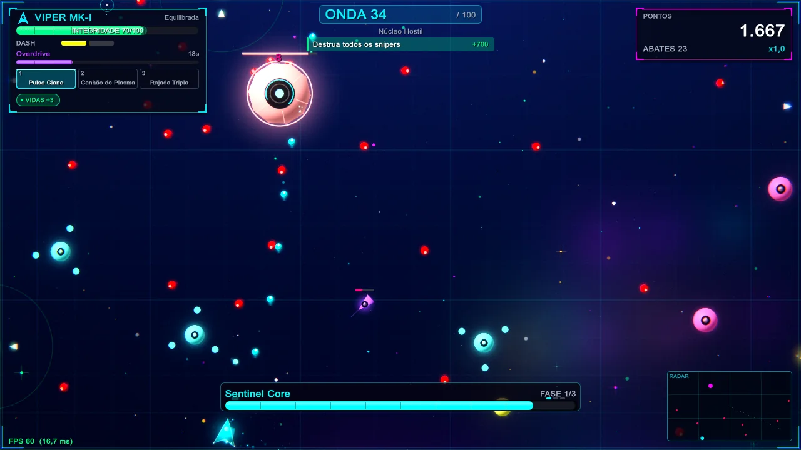
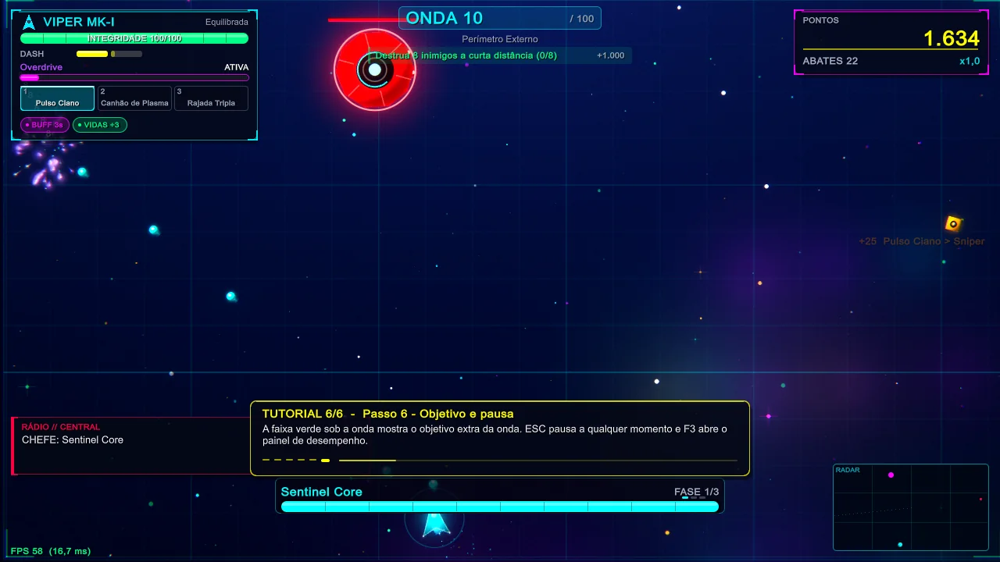
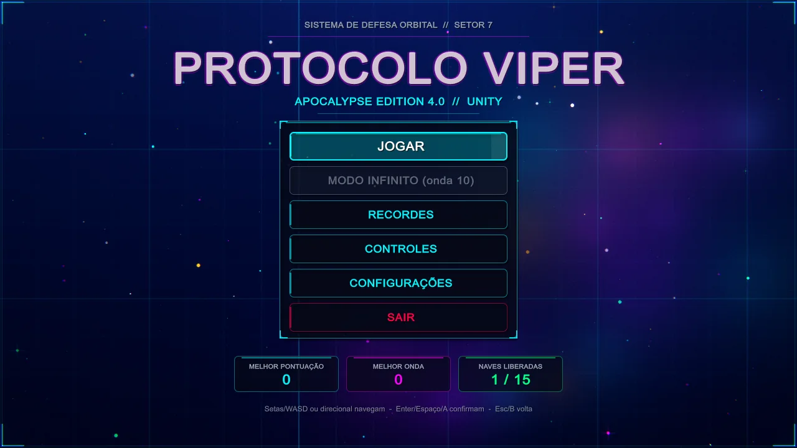
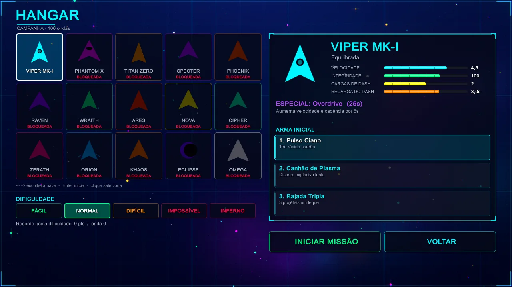
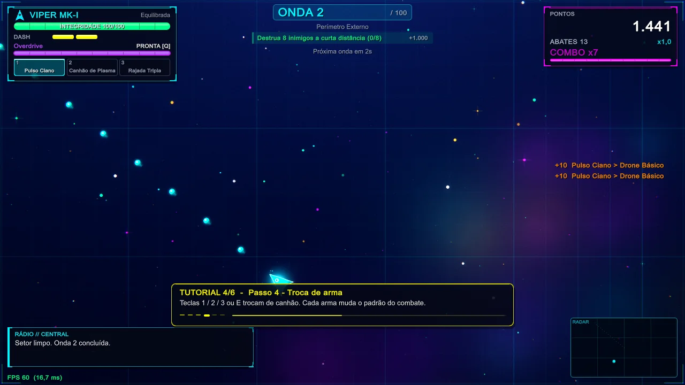
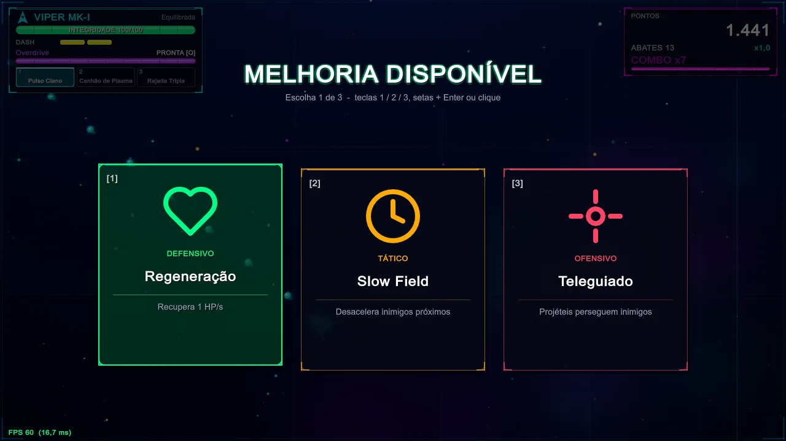
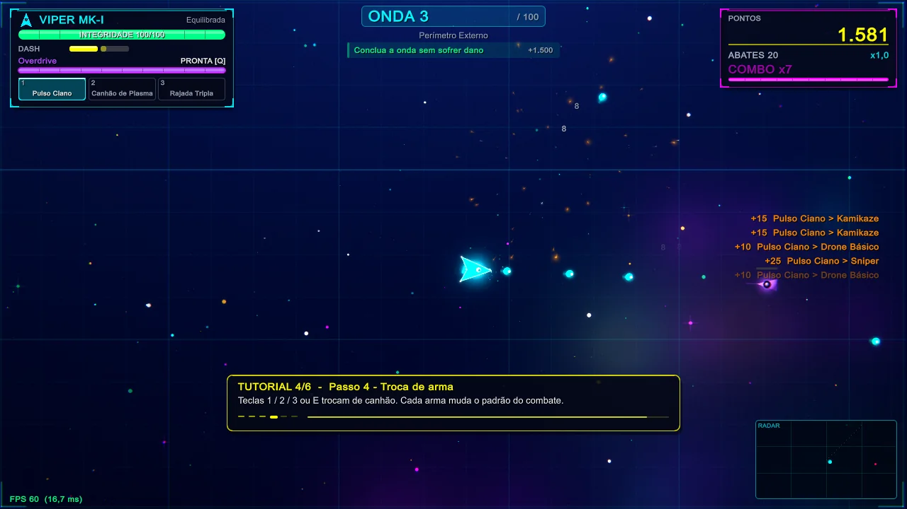
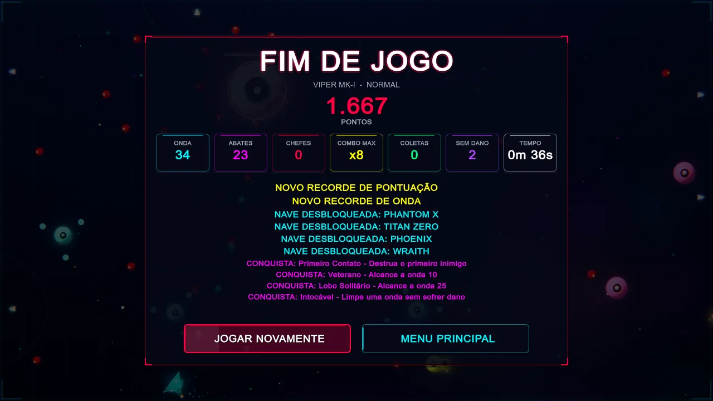
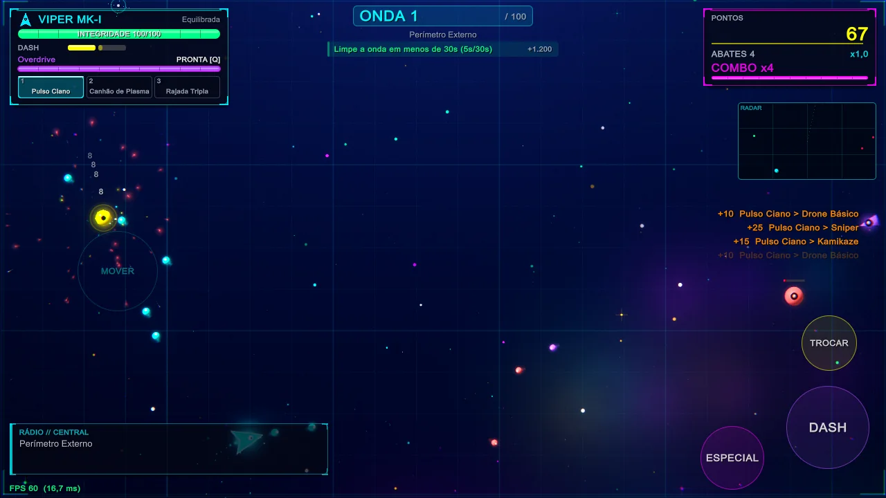
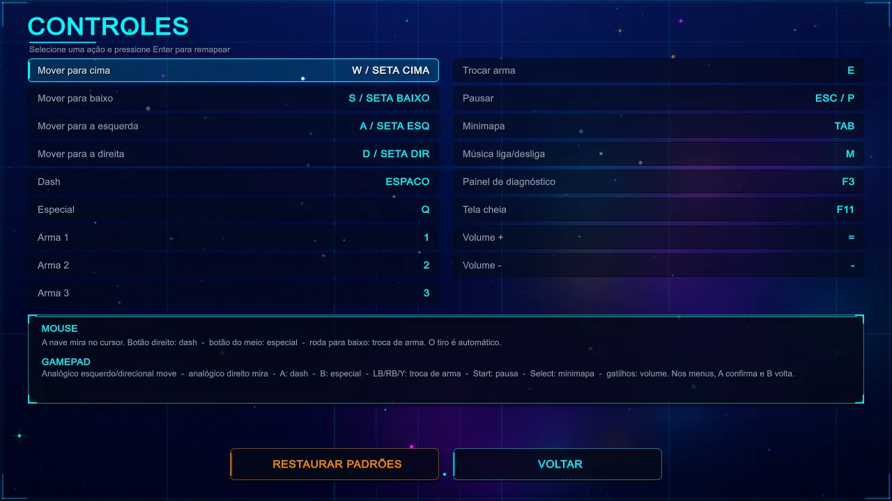

<div align="center">



# ⟁ PROTOCOLO VIPER

### Apocalypse Edition 4.0 · Remasterização visual 3.1

**Shooter espacial de arena em neon.** Escolha uma nave, sobreviva a 100 ondas, derrube chefes gigantes e monte sua build a cada vitória.

<br>

<a href="../../releases/latest/download/ProtocoloViper-3.1-remasterizacao-visual.zip">
  
</a>

<br><br>


</div>

---

## O jogo em números

<div align="center">

| 🌊 **100** | 🚀 **15** | 👾 **15** | 🎯 **13** | ⚡ **24** | 🔥 **5** |
|:---:|:---:|:---:|:---:|:---:|:---:|
| ondas | naves | chefes | tipos de inimigo | melhorias | dificuldades |

</div>

---

## Como é o jogo

Você pilota uma nave numa arena vista de cima. Ela se move pelo teclado, pelo analógico ou com o polegar, mira com o mouse e **atira sozinha**. Por isso, o que importa é o posicionamento, a esquiva e as escolhas de build.

Cada onda traz **objetivos bônus**, como destruir inimigos a curta distância ou terminar sem levar dano. Um chefe aparece a cada 5 ondas. Os chefes principais vêm nas ondas **10, 25, 50, 75 e 100**: *Sentinel Core*, *Mecha Serpent*, *Gravity Overlord*, *Aegis Titan* e *NEON TITAN*.

A campanha atravessa cinco setores, do Perímetro Externo ao Colapso Final. Quem chega à onda 10 libera o **modo infinito**.

| | Etapa | O que acontece |
|:---:|---|---|
| **01** | **Escolha a nave** | No hangar você escolhe a nave, uma das 3 armas dela e a dificuldade, de Fácil a Inferno |
| **02** | **Sobreviva** | Use o dash para desviar, o especial para virar a luta e troque de arma conforme o inimigo |
| **03** | **Evolua** | Escolha 1 de 3 melhorias (defensivas, táticas ou ofensivas); power-ups também caem durante a luta |
| **04** | **Desbloqueie** | Ondas, abates e chefes derrotados liberam novas naves e 14 conquistas |

---

## Capturas reais

> Todas as imagens foram tiradas do executável Windows rodando em 1280×720, sem retoque.

<div align="center">


<sub><b>Luta contra chefe</b>: Sentinel Core, com barra de vida e fases</sub>

<br><br>

<table>
  <tr>
    <td width="50%"><br><sub><b>Menu principal</b></sub></td>
    <td width="50%"><br><sub><b>Hangar</b>: nave, arma e dificuldade</sub></td>
  </tr>
  <tr>
    <td><br><sub><b>Combate</b>: tutorial, objetivos e radar</sub></td>
    <td><br><sub><b>Melhorias</b>: escolha 1 de 3</sub></td>
  </tr>
  <tr>
    <td><br><sub><b>Objetivos bônus</b> e abates por arma</sub></td>
    <td><br><sub><b>Fim de partida</b>: estatísticas e conquistas</sub></td>
  </tr>
  <tr>
    <td><br><sub><b>Modo toque</b>: analógico e botões na tela</sub></td>
    <td><br><sub><b>Controles</b>: tudo remapeável</sub></td>
  </tr>
</table>

</div>

---

## As 15 naves

Cada nave tem atributos próprios, três armas e uma habilidade especial. A **VIPER MK-I** já começa liberada; as outras são desbloqueadas jogando.

| Nave | Estilo | Especial | Como liberar |
|---|---|---|---|
| **VIPER MK-I** | Equilibrada | **Overdrive**: velocidade e cadência maiores por 5 s | Liberada desde o início |
| **PHANTOM X** | Ágil / Stealth | **Phase Shift**: invencível e atravessa inimigos | Chegar à onda 5 |
| **TITAN ZERO** | Tanque pesado | **Fortress Mode**: escudo impenetrável por 4 s | Chegar à onda 10 |
| **SPECTER** | Assassina | **Shadow Step**: teleporta para trás do alvo mais próximo | Acumular 400 eliminações |
| **PHOENIX** | Regeneração | **Rebirth**: revive com 50% de vida ao morrer (1 vez) | Chegar à onda 20 |
| **RAVEN** | Mestre de drones | **Drone Swarm**: invoca 4 drones de combate | Derrotar 2 chefes |
| **WRAITH** | Roubo de vida | **Soul Harvest**: drena 20% da vida de todos na área | Chegar à onda 30 |
| **ARES** | Berserker | **Blood Rage**: dano +100% com vida abaixo de 30% | Somar 250.000 pontos no total |
| **NOVA** | Controle de área | **Supernova**: explosão massiva em 360° | Chegar à onda 40 |
| **CIPHER** | Hacker | **System Crash**: dano e atordoamento em todos os inimigos | Chegar à onda 25 no Difícil ou acima |
| **ZERATH** | Andarilho do vazio | **Dimension Rift**: portal que teleporta projéteis | Chegar à onda 55 |
| **ORION** | Sniper | **Orbital Strike**: laser orbital de alto dano | Conquistar a proeza Combo Master |
| **KHAOS** | Aleatória | **Entropy Wave**: efeito aleatório poderoso | Chegar à onda 70 |
| **ECLIPSE** | Manipula o tempo | **Time Stop**: para o tempo por 3 s | Derrotar 6 chefes |
| **OMEGA** | Suprema | **Omega Protocol**: ativa todos os bônus ao mesmo tempo | Completar a onda 100 |

---

## Destaques

- 🎨 **Visual neon feito por código.** Naves, inimigos, nebulosas e efeitos são desenhados em tempo real, sem texturas, com bloom, correção de cor e brilho em cada projétil.
- 🎵 **Trilha sintetizada.** A música e os efeitos sonoros são gerados pelo próprio jogo durante a partida.
- 🎮 **Teclado, gamepad e toque.** Os controles são remapeáveis no PC, o gamepad é suportado e o Android tem analógico flutuante.
- ♿ **Acessibilidade.** Há opções para reduzir flashes, reduzir o tremor de tela e ativar alto contraste.
- 💾 **Progresso salvo** com backup automático: recordes, naves e conquistas.

---

## Controles

O tiro é sempre automático. No PC, todas as teclas podem ser trocadas na tela **Controles**.

<details open>
<summary><b>⌨️ Teclado e mouse</b></summary>

| Tecla | Ação |
|---|---|
| `W` `A` `S` `D` ou setas | Mover |
| Mouse | Mirar |
| `Espaço` ou botão direito | Dash |
| `Q` ou botão do meio | Habilidade especial |
| `1` `2` `3` | Escolher arma |
| `E` ou roda do mouse | Trocar arma |
| `Esc` ou `P` | Pausar |
| `Tab` | Minimapa |
| `M` | Música liga/desliga |
| `F11` | Tela cheia |
| `=` / `-` | Volume |
| `F3` | Diagnóstico (FPS) |

</details>

<details>
<summary><b>🎮 Gamepad</b></summary>

| Botão | Ação |
|---|---|
| Analógico esquerdo ou D-pad | Mover |
| Analógico direito | Mirar |
| `A` / `Cruz` | Dash |
| `B` / `Círculo` | Habilidade especial |
| `LB` `RB` `Y` | Trocar arma |
| `Start` | Pausar |
| `Select` | Minimapa |
| `RT` / `LT` | Volume |

</details>

<details>
<summary><b>📱 Toque (Android)</b></summary>

| Gesto | Ação |
|---|---|
| Polegar esquerdo | Analógico flutuante (aparece onde o dedo encosta) |
| Polegar direito (canto inferior direito) | Mirar |
| Botões DASH, ESPECIAL e TROCAR | Dash, habilidade e troca de arma |
| Três dedos na tela | Pausar |

</details>

---

## Download

<div align="center">

<a href="../../releases/latest/download/ProtocoloViper-3.1-remasterizacao-visual.zip">
  
</a>

**94,4 MB** (98.947.161 bytes) · Windows x64 + Android arm64 + projeto Unity

Todas as versões ficam em **[Releases](../../releases)**.

</div>

<details>
<summary><b>🔒 Conferir se o arquivo veio inteiro (SHA-256)</b></summary>

```
6b580a1dc4e8af4817482ea877b34477affdf12dd5cf86f2a73d7a7030e6d2e7
```

No Windows, abra o PowerShell na pasta do arquivo e rode:

```powershell
Get-FileHash .\ProtocoloViper-3.1-remasterizacao-visual.zip
```

O resultado precisa ser igual ao código acima.

</details>

### O que vem dentro do ZIP

```
ProtocoloViper-3.1/
├─ LEIA-ME.txt                  ← comece por aqui
├─ Builds/
│  ├─ PC/Windows/
│  │  └─ ProtocoloViper.exe     ← o jogo
│  └─ Mobile/Android/
│     └─ ProtocoloViper.apk     ← 16,8 MB
├─ Projeto_Unity/               ← código-fonte
│  ├─ Assets/  Packages/
│  ├─ ProjectSettings/
│  └─ README.md
└─ Documentacao/
   ├─ RELATORIO-DE-VALIDACAO.md
   ├─ REMASTERIZACAO-VISUAL.md
   ├─ capturas/                 ← 60 imagens
   └─ validacao/                ← testes e logs
```

---

## O que fazer depois de baixar

### 1️⃣ Extraia o ZIP
Clique com o botão direito no arquivo e escolha **Extrair tudo…**. Use uma pasta simples, como `C:\Jogos`.

> [!WARNING]
> Não abra o jogo de dentro do ZIP. Ele precisa das outras pastas ao lado do `.exe` para iniciar.

### 2️⃣ Jogue no PC
Entre em `ProtocoloViper-3.1\Builds\PC\Windows` e dê dois cliques em **`ProtocoloViper.exe`**. Não precisa instalar nada nem ter a Unity.

> [!NOTE]
> Se aparecer **"O Windows protegeu o computador"**, clique em **Mais informações** e depois em **Executar assim mesmo**. O aviso aparece porque o executável não tem assinatura digital de editora.

Para levar o jogo para outro lugar, copie a pasta `Windows` inteira, não só o `.exe`.

### 3️⃣ Instale no Android (opcional)
Copie `Builds\Mobile\Android\ProtocoloViper.apk` para o celular, abra o arquivo e permita **instalar apps de fontes desconhecidas** quando o Android pedir. Pelo computador, também dá para usar `adb install ProtocoloViper.apk`.

Precisa de Android 7.1 ou mais novo em aparelho 64 bits (arm64).

> [!CAUTION]
> O APK foi compilado e conferido como pacote válido, mas **ainda não foi testado em um aparelho**. Ele usa assinatura de depuração: serve para testes, não para publicar na Google Play.

### 4️⃣ Abra o projeto na Unity (para editar)
1. Instale o **Unity Hub** e a Unity **6000.3.9f1** com o módulo *Windows Build Support*. Para gerar APK, adicione também *Android Build Support* com SDK, NDK e IL2CPP.
2. No Unity Hub, clique em **Add** e selecione a pasta `Projeto_Unity`. A primeira abertura leva alguns minutos.
3. Abra `Assets/Scenes/Main.unity` e aperte **Play**. A cena é vazia de propósito, porque o jogo monta tudo por código.
4. Para gerar executáveis, use o menu **Protocolo Viper → Build Windows x64** ou **Build Android (APK)**.

### 5️⃣ Leia a documentação
O `LEIA-ME.txt` resume tudo. A pasta `Documentacao` tem o relatório de validação, a lista de mudanças da remasterização, 60 capturas em quatro resoluções e os resultados dos testes automáticos (**41 de 41 aprovados**).

---

## Requisitos e desempenho

<table>
<tr>
<td width="50%" valign="top">

### 💻 Requisitos no PC
- Windows 10 ou 11, 64 bits
- Placa de vídeo com DirectX 12
- ~160 MB livres para extrair tudo (só o jogo de PC ocupa 87 MB)
- Funciona offline, sem conta e sem internet

</td>
<td width="50%" valign="top">

### 📊 Desempenho medido
Num **Intel i7-13700 + RTX 3060**, em 1280×720 na qualidade alta e sem limite de FPS, a média ficou entre **995 e 1066 FPS** nos três cenários testados: ondas 1 a 4, onda 24 e onda 25 (com chefe).

<sub>Os números são de uma única máquina; em outro hardware os resultados mudam.</sub>

</td>
</tr>
<tr>
<td valign="top">

### 💾 Onde fica o save
```
%USERPROFILE%\AppData\LocalLow\ProtocoloViper\Protocolo Viper\
```
Para desinstalar, apague a pasta do jogo. Para zerar o progresso, apague também essa pasta de save.

</td>
<td valign="top">

### ⚠️ Limitações conhecidas
- Sem versão para Linux ou iOS neste pacote
- APK ainda não testado em celular
- Recorde só local, sem ranking online

</td>
</tr>
</table>

---

<div align="center">

**⟁ PROTOCOLO VIPER** · Apocalypse Edition 4.0 · Feito com Unity 6

<sub>Sistema de defesa orbital // Setor 7</sub>

</div>
